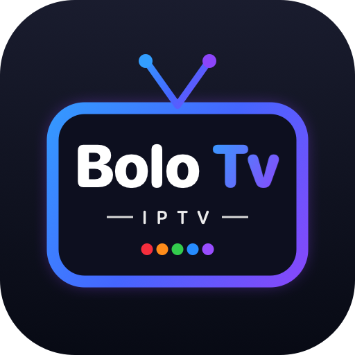

<p align="center"></p>

<h1 align="center">Bolo TV</h1>

<p align="center">IPTV-Player für <b>Android TV, Fire TV, Handy und Tablet</b> – Live-TV, Filme und Serien deines Anbieters,<br>
nach Ländern sortiert, mit Logos, Programm und Fernwartung.</p>

<p align="center">
  <a href="https://github.com/doctorsoffix/bolotv/releases/latest/download/bolotv.apk"><b>⬇︎ Neueste Version herunterladen</b></a> ·
  <a href="https://doctorsoffix.github.io/bolotv/">Webseite</a>
</p>

---

## Was ist in diesem Projekt?

Dieses Projekt enthält **nur die fertige App und ihre Daten**, nicht den Quellcode. Die App gehört doctor.soffix;
der Quellcode ist nicht öffentlich.

| Datei | Wofür |
|---|---|
| [Releases](https://github.com/doctorsoffix/bolotv/releases) | Die installierbaren APK-Dateien, jede Version einzeln |
| `update.json` | Neueste Version – die App fragt hier nach Updates |
| `config.json` | Einstellungen für alle Geräte (z. B. neue Serveradresse), **verschlüsselt** |
| `docs/` | Webseite mit Download und Anleitung (GitHub Pages) |

`config.json` ist mit dem Schlüssel der App verschlüsselt. Ohne ihn kann niemand die Einträge lesen oder
gültige Einstellungen für die Geräte erzeugen.

## Installation

**Android TV / Fire TV:** App *Downloader* installieren, „unbekannte Quellen“ erlauben und diese Adresse öffnen:

```
github.com/doctorsoffix/bolotv/releases/latest/download/bolotv.apk
```

**Handy / Tablet:** Den Download-Link oben antippen und die Installation erlauben.

## Einrichtung

Beim ersten Start fragt die App, wie sie eingerichtet werden soll:

- **Einrichtung durch Anbieter** – die App zeigt eine Nummer (MAC-Adresse oder Gerätecode). Dein Anbieter
  aktiviert die App und trägt deinen Zugang aus der Ferne ein.
- **Manuelle Einrichtung** – Aktivierungscode (oder Testcode für 24 Stunden) eingeben, danach den Xtream-Zugang
  oder die M3U-Liste selbst eintragen.

## Updates

Die App sieht regelmäßig nach einer neuen Version und bietet sie zur Installation an
(Einstellungen → *Nach Updates suchen*). Android fragt beim ersten Mal nach der Erlaubnis, Apps zu installieren.

## Hinweis

Bolo TV ist ein Abspielprogramm und liefert selbst keine Sender, Filme oder Serien. Die Inhalte kommen vom
eigenen Anbieter des Nutzers.

---

© doctor.soffix – alle Rechte vorbehalten. Weitergabe, Veränderung oder Zerlegung der App ist nicht erlaubt.
